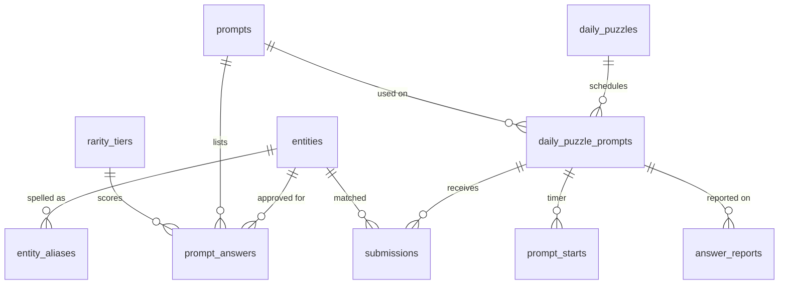

# Curated answer database

Issue #10. The database stores reviewed answer lists. It does not store career spells, caps, or honours, and a prompt is not a query. Why an answer is valid lives in `source_notes` and the research notes.

`entities` is one row per player or club curated, with a disambiguation line and an optional Wikidata id. `entity_aliases` is one alias table for both. `prompt_answers` is the list reviewed, with a fame rating from 1 to 5. `prompt_starts` is the server time a session first saw a scheduled prompt.